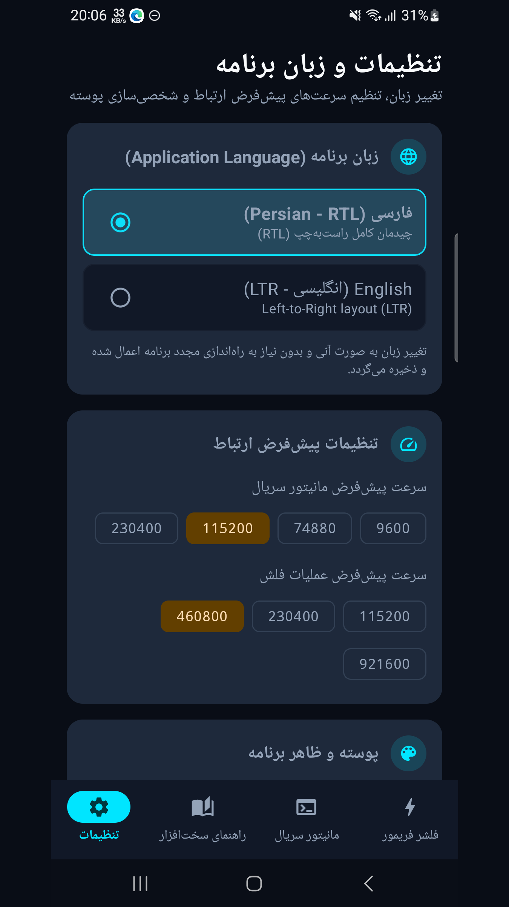
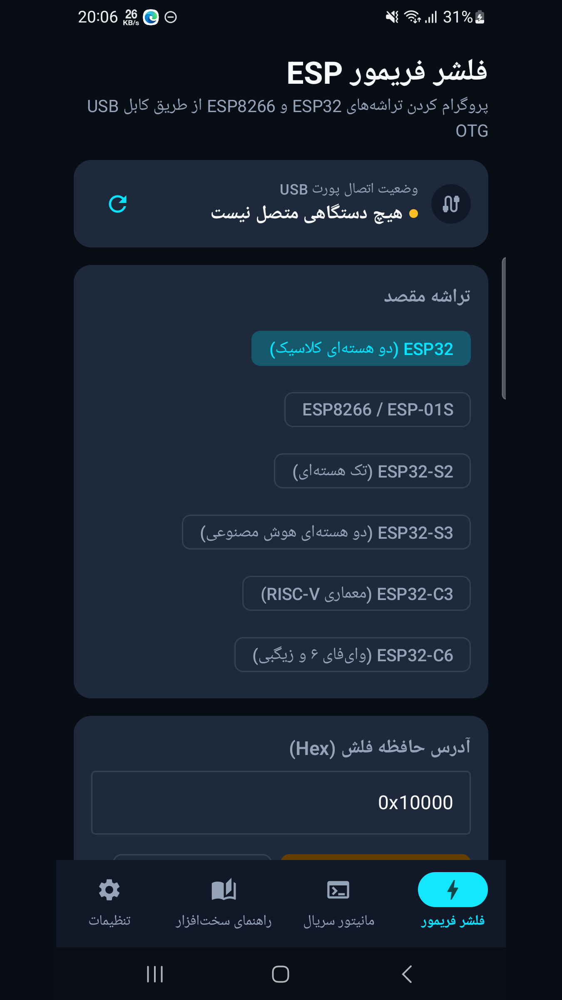
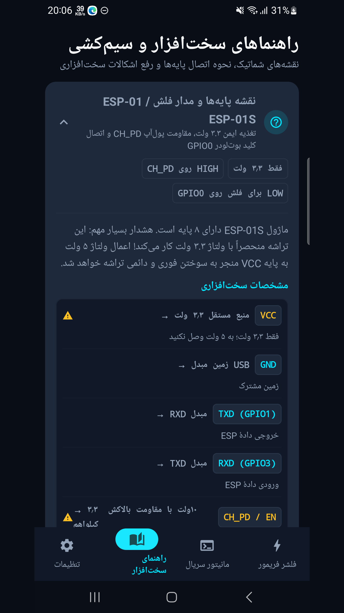
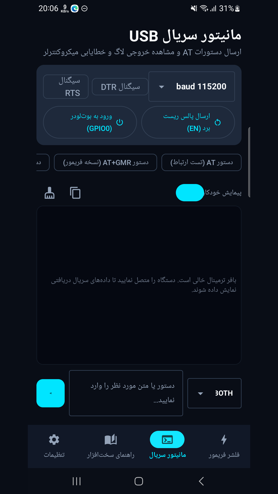
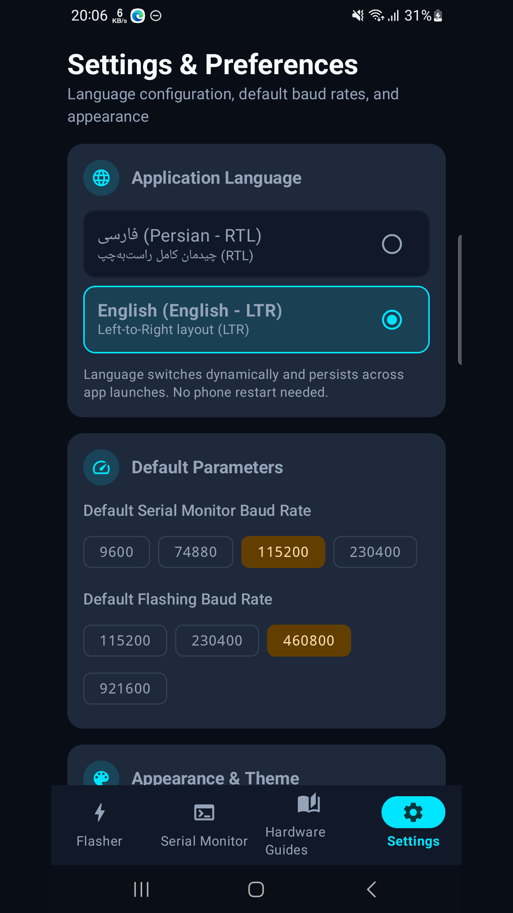
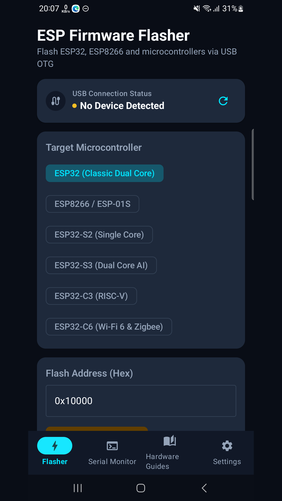
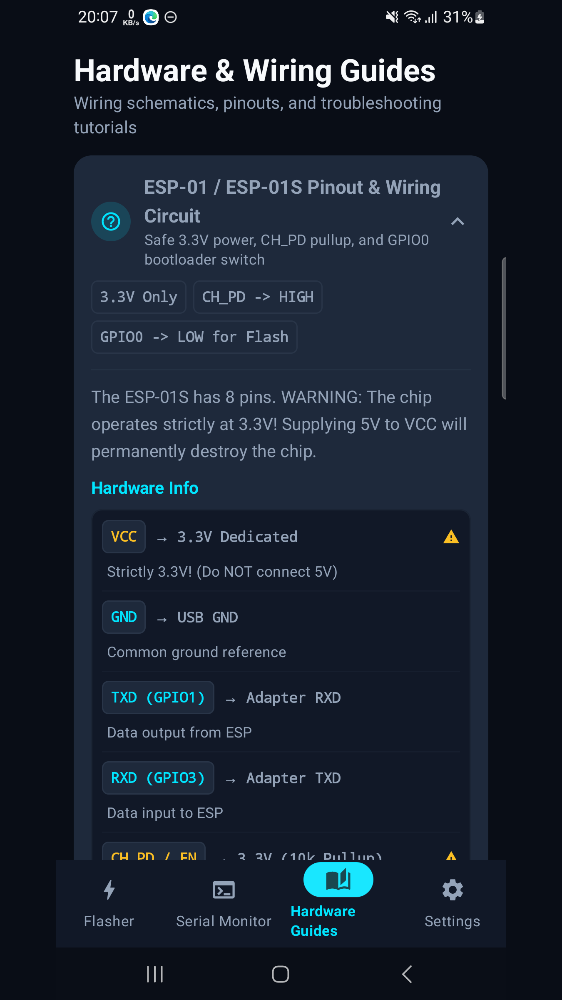
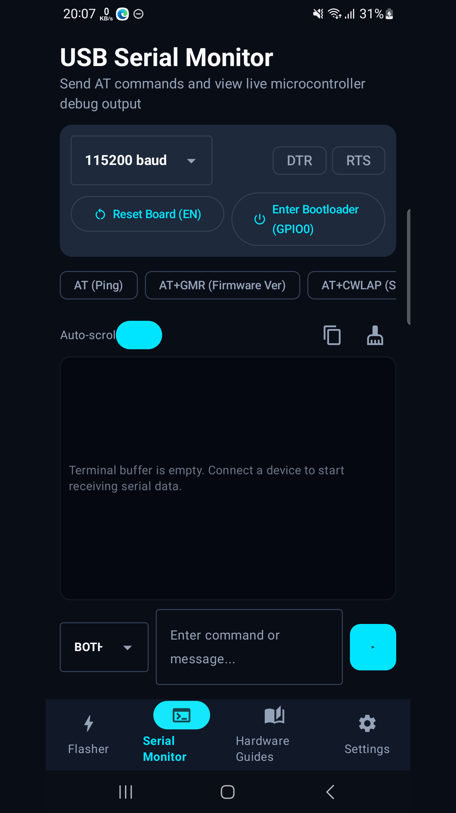

# ESP Flasher | فلشر ESP

[Download / دریافت APK](https://github.com/cinaasadpour-hash/esp-flasher/releases/tag/v1.0.2)

Package: `com.sinatools.espflasher` · Version: **1.0.2** · Version code: **3**

## فارسی

نوشتن فریم‌ور بردهای پشتیبانی‌شدهٔ ESP از طریق USB و مانیتور سریال.

فلشر ESP برای نوشتن فایل فریم‌ور روی بردهای پشتیبانی‌شدهٔ ESP از طریق USB و استفاده از مانیتور سریال طراحی شده است. فایل معتبر را انتخاب کنید، آدرس نوشتن و تنظیمات اتصال را مشخص کنید و روند عملیات را ببینید.

برای اتصال، گوشی دارای پشتیبانی USB Host، مبدل OTG و کابل دادهٔ سازگار لازم است. ممکن است لازم باشد برد را دستی وارد حالت دانلود کنید. راهنمای اتصال و تنظیمات در برنامه قرار دارد.

برنامه رابط فارسی و انگلیسی دارد. پشتیبانی همهٔ بردها و مبدل‌های USB تضمین نمی‌شود. انتخاب فایل یا آدرس نادرست می‌تواند فریم‌ور برد را خراب کند؛ پیش از شروع، اطلاعات سازندهٔ برد را بررسی کنید.

## English

Flash supported ESP boards over USB and use a serial monitor.

ESP Flasher writes firmware files to supported ESP boards over USB and provides a serial monitor. Select a valid firmware file, specify its flash address and connection settings, and follow operation progress.

A USB Host-capable phone, a compatible OTG adapter and a data cable are required. Your board may need to be placed in download mode manually. Connection guidance and settings are available in the app.

Persian and English interfaces are supported. Compatibility with every board or USB adapter is not guaranteed. An incorrect firmware file or flash address can damage the board firmware; check the board manufacturer's instructions before starting.

## Privacy / حریم خصوصی

See [Privacy / حریم خصوصی](PRIVACY.md). Store listing text in both languages is available in [store-listing](store-listing).

## Verification / بررسی

The signed APK was installed and launched on a Samsung Galaxy A32 with Android 13 on 2026-10-30, with existing app data preserved. The installed APK checksum matched the release file. Production Tapsell identifiers and the release certificate were checked in the APK. Detailed visual and functional coverage varies by app; this is not a guarantee of compatibility with every device or external service.

نسخهٔ امضاشده در ۳۰ اکتبر ۲۰۲۶ روی گوشی نصب و اجرا شد و اطلاعات قبلی حفظ شد. اثرانگشت نسخهٔ نصب‌شده با فایل انتشار برابر بود. نام بسته، امضا و شناسه‌های واقعی تپسل در APK بررسی شدند. محدودهٔ آزمون هر برنامه متفاوت است و سازگاری با همهٔ دستگاه‌ها و خدمات تضمین نمی‌شود.

Physical board flashing was not repeated in this review. / فلش روی برد واقعی در این بررسی تکرار نشد.

## تصاویر برنامه

## Screenshots

